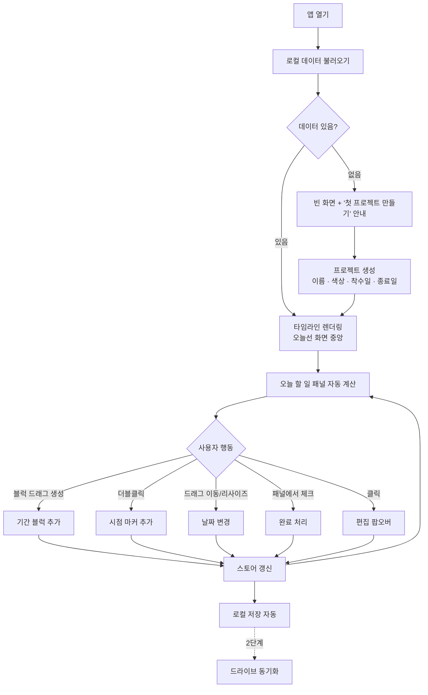
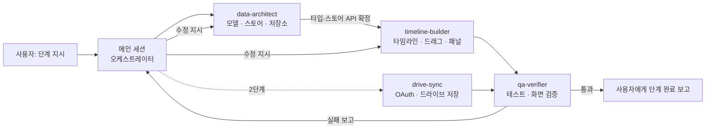

# 업무 타임라인 서비스 기획서 (MVP)

> 가칭: **Today Line** (이름은 확정 전. 브랜딩 단계에서 교체)
> 작성일: 2026-10-20 · 용도: Claude Code에 가져가 단계별로 구현하기 위한 기획서

---

## 0. 한 줄 정의

여러 프로젝트를 세로로 쌓아 놓고, 각 프로젝트 안에 **기간 블럭**과 **시점 마커**를 배치한 뒤, 오늘 날짜에 그어진 세로선에 걸린 항목을 **"오늘 할 일" 패널**로 모아 보여주는 개인용 업무 타임라인.

해결하려는 문제는 하나다. **동시에 여러 일을 하다가 특정 시점에 챙겨야 할 것을 잊는 것.** 모든 기능은 이 문제에 기여하는지로 판단한다.

---

## 1. 확정된 결정사항

| 항목 | 결정 |
|---|---|
| 블럭 형태 | 기간 블럭(시작~종료) + 시점 마커(특정일 하루) 둘 다 |
| 기본 화면 | 월 단위, 오늘을 중심으로 약 3개월 표시. 주/월/분기 줌 전환 |
| 오늘 표시 | 오늘 날짜 세로선 + 세로선에 걸린 항목을 모은 "오늘 할 일" 패널(완료 체크 가능) |
| 저장 | **1단계(MVP): 브라우저 로컬 저장(IndexedDB) + JSON 내보내기/불러오기** <br> **2단계: 구글 드라이브 JSON 파일 동기화** (`drive.file` 권한) |
| 사용 기기 | 데스크톱 브라우저 우선. 모바일은 2단계 이후 "오늘 할 일" 확인 위주 |
| 사용자 | 본인 1인. 로그인·권한·협업 기능 없음 |

---

## 2. 기술 스택 (Claude Code에 지정할 값)

| 영역 | 선택 | 이유 |
|---|---|---|
| 프레임워크 | React + TypeScript + Vite | 단일 페이지 앱, 서버 불필요, 정적 호스팅 가능 |
| 상태 관리 | Zustand | 보일러플레이트가 적고 저장소 계층 분리가 쉬움 |
| 로컬 저장 | Dexie (IndexedDB 래퍼) | localStorage보다 용량·안정성 우위 |
| 날짜 계산 | date-fns | 함수 단위 import, 한국어 로케일 지원 |
| 드래그/리사이즈 | **직접 구현 (Pointer Events)** | 타임라인은 "가로축=날짜" 스냅 계산이 핵심이라 범용 DnD 라이브러리보다 직접 구현이 단순함 |
| 스타일 | CSS Modules 또는 Tailwind (Claude Code 판단에 위임) | — |
| 폰트 | Pretendard (웹폰트) | 한국어 UI 가독성 |
| 테스트 | Vitest(로직 단위 테스트) + Playwright MCP(화면 검증) | — |
| 배포(2단계) | Vercel 또는 GitHub Pages | 구글 OAuth에 등록할 고정 주소가 필요 |

**날짜 처리 원칙(중요).** 모든 날짜는 시간 없이 `"YYYY-MM-DD"` 문자열로 저장하고, 계산할 때만 로컬 날짜로 변환한다. `Date` 객체나 UTC 타임스탬프로 저장하면 KST(UTC+9) 경계에서 하루씩 밀리는 버그가 생긴다.

---

## 3. 화면 구성

```
┌──────────────────────────────────────────────────────────────┬──────────────────┐
│ [+ 프로젝트]  [주|월|분기]  [◀ 오늘 ▶]   [내보내기][불러오기]  │  오늘 할 일       │
├──────────────┬───────────────────────────────────────────────┤  10월 20일(화)    │
│              │  9월        │  10월    ┃     │  11월           │                  │
│ 프로젝트 A ● │ ░░░░░░░░░░░░░░░░░░░░░░░░┃░░░░░░░░░░░           │ ▸ 진행 중         │
│              │   [착수보고 준비 ███]    ┃[중간점검 ████]       │  □ A · 중간점검   │
│              │                    ◆10/15┃                     │  □ B · 원고 작성  │
├──────────────┼─────────────────────────┃─────────────────────┤ ▸ 오늘 마감       │
│ 프로젝트 B ● │      ░░░░░░░░░░░░░░░░░░░┃░░░░░░░░░░░░░░░░     │  □ C · 공문 회신  │
│              │        [원고 작성 ██████┃████]                │ ▸ 7일 이내 마커   │
├──────────────┼─────────────────────────┃─────────────────────┤  ◆ A · 보고서 10/24│
│ 프로젝트 C ● │                ░░░░░░░░░┃░░░░░░░░             │ ▸ 지난 미완료     │
│              │                         ◆ 공문 회신           │  ! B · 자료 요청   │
└──────────────┴─────────────────────────┸─────────────────────┴──────────────────┘
   ░ = 프로젝트 기간(착수~종료) 배경띠   █ = 기간 블럭   ◆ = 시점 마커   ┃ = 오늘선
```

### 3-1. 타임라인 영역
- **세로축:** 프로젝트 행. 왼쪽 고정 열에 프로젝트명과 색상 점.
- **가로축:** 날짜. 상단에 월/주 눈금, 주말은 옅은 음영.
- **프로젝트 기간:** 행 전체에 옅은 배경띠로 착수일~종료일 표시.
- **기간 블럭:** 프로젝트 색상의 막대. 제목이 블럭 안에 표시되고, 짧아서 안 들어가면 말줄임 후 호버 시 툴팁.
- **시점 마커:** 마름모(◆) + 짧은 라벨.
- **겹침 처리:** 같은 프로젝트에서 기간이 겹치는 블럭은 아래 줄(lane)로 자동 배치하고, 행 높이는 lane 수만큼 늘어남.
- **오늘선:** 오늘 날짜 중앙을 관통하는 굵은 세로선, 상단에 "오늘" 라벨. 오늘선에 걸린 블럭은 테두리 강조.
- **완료된 항목:** 채도를 낮추고 체크 아이콘 표시. 숨김 토글 제공.
- **프로젝트 기간 밖의 블럭:** 허용하되 점선 테두리로 경고 표시.

### 3-2. 조작 (구글 캘린더 방식)
| 동작 | 결과 |
|---|---|
| 프로젝트 행의 빈 곳을 가로로 드래그 | 해당 기간으로 새 기간 블럭 생성 → 제목 입력 팝오버 |
| 빈 곳 더블클릭 | 그 날짜에 새 시점 마커 생성 |
| 블럭 몸통 드래그 | 기간 길이를 유지한 채 날짜 이동 (일 단위 스냅) |
| 블럭 좌/우 끝 드래그 | 시작일/종료일 변경 |
| 마커 드래그 | 날짜 이동 |
| 블럭/마커 클릭 | 편집 팝오버: 제목, 유형, 날짜, 색상, 메모, 완료, 삭제 |
| `Esc` | 드래그 취소 / 팝오버 닫기 |
| `Delete` | 선택 항목 삭제 (확인창) |

드래그 중에는 변경될 날짜를 말풍선으로 실시간 표시한다("10/21 ~ 10/28, 8일").

### 3-3. 색상
- 프로젝트마다 색상 1개. 프리셋 팔레트 10색 + 직접 선택(color input).
- 블럭과 마커는 기본적으로 프로젝트 색상을 상속하고, 항목별로 덮어쓸 수 있음.
- 프리셋은 서로 구분이 잘 되고 흰 글자가 읽히는 중간 명도로 구성.

### 3-4. "오늘 할 일" 패널
네 그룹으로 나눈다. 각 항목에 체크박스가 있고, 체크하면 `done=true`가 저장되며 타임라인에도 즉시 반영된다. 항목을 클릭하면 타임라인이 해당 위치로 스크롤된다.

1. **진행 중** — 시작일 ≤ 오늘 ≤ 종료일인 미완료 기간 블럭
2. **오늘 마감** — 오늘 날짜의 미완료 시점 마커, 그리고 종료일이 오늘인 기간 블럭
3. **7일 이내 마커** — 앞으로 7일 안에 다가오는 시점 마커 (D-n 표시)
4. **지난 미완료** — 종료일/마커 날짜가 지났는데 완료 체크가 안 된 항목

> **가정 명시:** 사용자가 요청한 것은 1·2번(오늘선에 걸린 항목)이다. 3·4번은 "잊지 않기"라는 목적에 직결된다고 판단해 넣었다. 불필요하면 해당 그룹만 빼면 되도록 그룹 단위로 독립 구현한다.

### 3-5. 줌
- **주:** 하루 폭 약 120px, 약 3주 표시
- **월(기본):** 하루 폭 약 32px, 약 3개월 표시
- **분기:** 하루 폭 약 10px, 약 9개월 표시
- 가로 스크롤로 과거·미래 이동, `오늘` 버튼으로 오늘선을 화면 중앙에 복귀.

---

## 4. 데이터 모델

```ts
type ISODate = string; // "YYYY-MM-DD"

interface Project {
  id: string;            // nanoid 등
  name: string;
  color: string;         // "#RRGGBB"
  startDate: ISODate;    // 착수일
  endDate: ISODate;      // 종료일
  order: number;         // 세로 정렬 순서
  memo?: string;
  archived: boolean;     // 종료된 프로젝트 숨김용
  createdAt: string;     // ISO datetime
  updatedAt: string;
}

interface Block {
  id: string;
  projectId: string;
  kind: "period" | "marker";
  title: string;
  startDate: ISODate;
  endDate: ISODate;      // marker는 startDate와 동일
  color?: string;        // 없으면 프로젝트 색상 상속
  note?: string;
  done: boolean;
  doneAt?: string;
  createdAt: string;
  updatedAt: string;
}

interface AppData {      // 내보내기·드라이브 동기화 단위
  schemaVersion: 1;
  updatedAt: string;
  projects: Project[];
  blocks: Block[];
}
```

**저장소 인터페이스(2단계 대비, 1단계에서 반드시 분리).**

```ts
interface StorageAdapter {
  load(): Promise<AppData>;
  save(data: AppData): Promise<void>;
}
// 1단계: LocalAdapter (Dexie)
// 2단계: DriveAdapter 추가, SyncManager가 Local ↔ Drive를 조율
```

UI 컴포넌트는 Zustand 스토어만 바라보고, 스토어만 `StorageAdapter`를 호출한다. 이 경계를 지켜야 2단계에서 UI를 건드리지 않고 드라이브를 붙일 수 있다.

---

## 5. Workflow 차트

### 5-1. 사용 흐름 (사용자 관점)



### 5-2. 개발 흐름 (Claude Code 관점)



순서가 중요하다. **data-architect가 타입과 스토어 API를 먼저 확정**해야 timeline-builder가 그 위에서 작업한다. 둘을 동시에 돌리면 인터페이스가 어긋난다.

---

## 6. Subagents 구조

MVP 원칙에 따라 **1단계는 3개, 2단계에 1개 추가**한다. 메인 세션이 오케스트레이터 역할을 하고, 서브에이전트는 맡은 폴더 밖을 수정하지 않는다.

| 에이전트 | 단계 | 담당 범위 | 수정 가능한 경로 |
|---|---|---|---|
| `data-architect` | 1 | 타입, Zustand 스토어, StorageAdapter, 날짜 유틸, 오늘 할 일 계산 로직, JSON 내보내기/불러오기 | `src/types/`, `src/store/`, `src/storage/`, `src/lib/` |
| `timeline-builder` | 1 | 타임라인 그리드, 줌, 오늘선, 블럭·마커 렌더링, lane 배치, 드래그/리사이즈, 편집 팝오버, 색상 선택, 오늘 할 일 패널 UI | `src/components/`, `src/styles/` |
| `qa-verifier` | 1 | 단위 테스트 작성·실행, Playwright MCP로 실제 화면 조작 검증, 결과 보고. **기능 코드는 수정하지 않음** | `tests/`, `src/**/*.test.ts` |
| `drive-sync` | 2 | Google Identity Services 로그인, Drive API 파일 찾기/생성/읽기/쓰기, SyncManager, 충돌 감지, 동기화 상태 표시 | `src/storage/drive/`, `src/sync/` |

### 6-1. 에이전트 정의 파일

`.claude/agents/` 폴더에 아래 파일을 그대로 만든다.

**`.claude/agents/data-architect.md`**
```markdown
---
name: data-architect
description: 데이터 모델, Zustand 스토어, 저장소 어댑터, 날짜 유틸, 오늘 할 일 계산 로직을 만들거나 고칠 때 사용한다. UI 작업 전에 먼저 호출한다.
tools: Read, Write, Edit, Bash, Glob, Grep
model: inherit
---
너는 이 프로젝트의 데이터 계층 담당이다.

규칙:
- 기획서(docs/PLAN.md) 4장의 데이터 모델을 따른다. 필드를 임의로 추가·삭제하지 않는다. 필요하면 이유와 함께 메인 세션에 제안만 한다.
- 날짜는 항상 "YYYY-MM-DD" 문자열로 저장한다. Date 객체나 UTC 타임스탬프로 저장하지 않는다.
- UI 컴포넌트는 스토어만 사용하고, 저장소(StorageAdapter)는 스토어만 호출하게 경계를 유지한다.
- 오늘 할 일 계산(진행 중 / 오늘 마감 / 7일 이내 마커 / 지난 미완료)은 순수 함수로 만들고, 기준 날짜를 인자로 받는다(테스트에서 날짜 고정 가능하도록).
- 수정 범위: src/types/, src/store/, src/storage/, src/lib/ 만.
- 작업이 끝나면 외부에 공개한 타입과 스토어 액션 목록을 요약해 보고한다.
```

**`.claude/agents/timeline-builder.md`**
```markdown
---
name: timeline-builder
description: 타임라인 화면, 줌, 오늘선, 블럭·마커 렌더링, 드래그 이동·리사이즈, 편집 팝오버, 색상 선택, 오늘 할 일 패널 UI를 만들거나 고칠 때 사용한다.
tools: Read, Write, Edit, Bash, Glob, Grep
model: inherit
---
너는 이 프로젝트의 UI 담당이다.

규칙:
- 데이터는 data-architect가 만든 스토어 API로만 읽고 쓴다. 스토어·타입 파일을 직접 수정하지 않는다. 필요한 변경은 메인 세션에 요청한다.
- 드래그/리사이즈는 Pointer Events로 직접 구현하고, 날짜 단위로 스냅한다. 드래그 중 변경될 날짜를 말풍선으로 보여준다. Esc로 취소된다.
- 겹치는 기간 블럭은 lane으로 자동 배치한다.
- 오늘선은 항상 보이게 하고, '오늘' 버튼으로 화면 중앙에 복귀한다.
- 한국어 UI, Pretendard 웹폰트. 날짜 표기는 "10월 20일(화)" 형식.
- 수정 범위: src/components/, src/styles/, src/App.tsx 만.
- 작업이 끝나면 구현한 조작 목록과 미구현 항목을 보고한다.
```

**`.claude/agents/qa-verifier.md`**
```markdown
---
name: qa-verifier
description: 단계가 끝날 때 테스트를 실행하고 Playwright MCP로 실제 화면을 조작해 기획서의 완료 기준을 검증할 때 사용한다. 기능 코드는 고치지 않는다.
tools: Read, Write, Edit, Bash, Glob, Grep, mcp__playwright
model: inherit
---
너는 검증 담당이다. 기능 코드는 수정하지 않는다.

절차:
1. `npm run test`로 단위 테스트를 실행한다. 오늘 할 일 계산과 날짜 유틸 테스트가 없으면 tests/ 에 작성한다.
2. 개발 서버를 띄우고 Playwright MCP로 브라우저를 열어, docs/PLAN.md 해당 단계의 "완료 기준"을 항목별로 직접 조작해 확인한다.
3. 결과를 항목별 통과/실패로 보고한다. 실패 항목은 재현 절차와 스크린샷 근거를 붙인다.
4. 통과하지 않은 항목을 통과로 보고하지 않는다. 확인하지 못한 항목은 "확인 불가"로 표시한다.
```

**`.claude/agents/drive-sync.md`** (2단계에서 추가)
```markdown
---
name: drive-sync
description: 구글 드라이브 동기화(로그인, 파일 찾기·생성·읽기·쓰기, 충돌 감지, 동기화 상태 표시)를 만들거나 고칠 때 사용한다.
tools: Read, Write, Edit, Bash, Glob, Grep
model: inherit
---
너는 구글 드라이브 동기화 담당이다.

규칙:
- OAuth 범위는 https://www.googleapis.com/auth/drive.file 하나만 쓴다. 더 넓은 범위를 요청하지 않는다.
- 로그인은 브라우저용 Google Identity Services 토큰 방식으로 구현한다. 클라이언트 ID는 .env의 VITE_GOOGLE_CLIENT_ID에서 읽고, 코드에 하드코딩하지 않는다. 클라이언트 시크릿은 쓰지 않는다.
- 로컬 저장이 항상 먼저다. 드라이브 실패가 앱 사용을 막으면 안 된다.
- 파일명은 worktimeline-data.json. 앱 시작 시 드라이브에서 찾고, 없으면 만든다.
- 쓰기 전에 드라이브 파일의 수정 시각을 확인해, 마지막 동기화 이후 다른 기기에서 바뀌었으면 덮어쓰지 말고 사용자에게 선택지(드라이브 버전 불러오기 / 이 기기 버전으로 덮어쓰기)를 보여준다.
- 수정 범위: src/storage/drive/, src/sync/, 그리고 동기화 상태 표시용 컴포넌트 1개.
```

---

## 7. 단계별 계획

각 단계는 **완료 기준을 qa-verifier가 통과시켜야 다음 단계로 넘어간다.**

### 0단계 — 프로젝트 준비

작업
- Vite + React + TypeScript 프로젝트 생성, Zustand · Dexie · date-fns 설치
- 이 기획서를 `docs/PLAN.md`로 저장
- 프로젝트 `CLAUDE.md` 작성 (부록 A)
- `.claude/agents/`에 1단계 에이전트 3개 생성 (6-1)
- Playwright MCP, Context7 MCP 연결 (8장)

완료 기준
- `npm run dev`로 빈 화면이 뜬다
- Claude Code에서 `/agents`에 세 에이전트가 보인다
- `/mcp`에 playwright, context7이 연결됨으로 보인다

### 1단계 — MVP: 로컬 타임라인

| 단계 | 담당 | 내용 |
|---|---|---|
| 1-1 | data-architect | 타입, 스토어(프로젝트·블럭 CRUD, 완료 토글), LocalAdapter(Dexie), 날짜 유틸, 오늘 할 일 계산 함수, 샘플 데이터 3개 프로젝트 |
| 1-2 | timeline-builder | 타임라인 그리드(월 눈금·주말 음영), 프로젝트 행·기간 배경띠, 블럭·마커 렌더링, lane 배치, 오늘선, 줌 3단계, 오늘 버튼 |
| 1-3 | timeline-builder | 드래그 생성/이동/리사이즈, 마커 더블클릭 생성·드래그, 편집 팝오버, 색상 팔레트, 프로젝트 추가·수정 폼 |
| 1-4 | timeline-builder | 오늘 할 일 패널(4그룹), 체크 시 완료 반영, 항목 클릭 시 타임라인 스크롤 |
| 1-5 | data-architect | JSON 내보내기/불러오기(불러오기 전 확인창, schemaVersion 검사) |
| 1-6 | qa-verifier | 전체 완료 기준 검증 |

완료 기준 (qa-verifier가 화면에서 직접 확인)
1. 프로젝트를 이름·색상·착수일·종료일로 만들면 세로로 쌓여 보인다
2. 오늘 날짜에 세로선이 있고, 앱을 열면 오늘선이 화면 중앙에 온다
3. 빈 곳을 드래그하면 기간 블럭이, 더블클릭하면 마커가 생긴다
4. 블럭을 드래그하면 기간을 유지한 채 이동하고, 끝을 드래그하면 기간이 바뀐다. 날짜 단위로 스냅된다
5. 겹치는 블럭이 서로 가리지 않고 아래 줄로 배치된다
6. 오늘선에 걸린 항목이 패널의 "진행 중"/"오늘 마감"에 나타나고, 체크하면 타임라인에도 완료로 표시된다
7. 색상을 바꾸면 프로젝트와 상속받은 블럭 색이 함께 바뀐다
8. 새로고침해도 데이터가 남는다
9. 내보낸 JSON을 다른 브라우저에서 불러오면 같은 화면이 나온다
10. 주/월/분기 줌이 전환된다
11. 오늘 할 일 계산 단위 테스트가 통과한다 (날짜 경계: 시작일 당일, 종료일 당일, 월말, 연말)

### 2단계 — 구글 드라이브 동기화

**사용자가 직접 해야 하는 준비** (Claude Code가 대신할 수 없음)
1. Google Cloud 콘솔에서 프로젝트 생성 → Drive API 사용 설정
2. OAuth 동의 화면 설정(외부, 본인 계정을 테스트 사용자로 추가) → 범위에 `drive.file` 추가
3. OAuth 클라이언트 ID 발급(웹 애플리케이션). 승인된 JavaScript 원본에 `http://localhost:5173`과 배포 주소 등록
4. 클라이언트 ID를 `.env`의 `VITE_GOOGLE_CLIENT_ID`에 입력

| 단계 | 담당 | 내용 |
|---|---|---|
| 2-1 | drive-sync | 로그인/로그아웃 버튼, 토큰 획득, 만료 시 재요청 |
| 2-2 | drive-sync | DriveAdapter: 파일 찾기·생성·읽기·쓰기 |
| 2-3 | drive-sync | SyncManager: 시작 시 드라이브에서 불러와 로컬과 비교, 변경 시 디바운스 업로드(예: 3초), 충돌 감지 |
| 2-4 | drive-sync | 상단에 동기화 상태 표시(동기화됨 / 저장 중 / 오프라인 / 로그인 필요) |
| 2-5 | 메인 세션 | Vercel 또는 GitHub Pages 배포 |
| 2-6 | qa-verifier | 완료 기준 검증 (로그인 화면은 사용자가 직접 로그인) |

완료 기준
1. 로그인하면 드라이브에 `worktimeline-data.json`이 생기고, 본인 드라이브에서 보인다
2. 기기 A에서 수정 → 기기 B에서 새로고침하면 반영된다
3. 로그인하지 않거나 오프라인이어도 로컬로 정상 사용된다
4. 두 기기에서 따로 수정하면 덮어쓰기 전에 선택지가 뜬다
5. 토큰이 만료되면 데이터 손실 없이 재로그인 안내가 뜬다

**알려진 제약**
- OAuth 앱을 '테스트' 상태로 두면 승인이 동의 후 7일 뒤 만료되어 주기적 재로그인이 필요하다. '프로덕션'으로 전환하면 이 제한은 풀린다. 비민감 범위(`drive.file`)만 쓰는 개인용 앱을 프로덕션 전환했을 때 '확인되지 않은 앱' 경고가 뜨는지는 **확인 불가** — 2-1에서 실제로 확인한다.
- 동시 편집 시 자동 병합은 하지 않는다(MVP 범위 밖).

### 3단계 — 후보 기능 (구현 여부는 2단계 이후 결정)
- 블럭을 다른 프로젝트 행으로 드래그해 옮기기
- 프로젝트 행 순서 드래그 변경, 프로젝트 기간 배경띠 드래그 조정
- 실행 취소(Ctrl+Z)
- 종료 프로젝트 보관함
- 모바일 전용 "오늘 할 일" 화면
- 블럭 템플릿(예: 보훈부 사업 = 착수보고·중간보고·결과보고 마커 세트 자동 생성)
- 아침 알림(브라우저 알림 또는 이메일)

---

## 8. 추천 MCP와 스킬

### 필수

**Playwright MCP** — qa-verifier가 실제 브라우저를 열어 드래그·클릭을 검증하는 데 쓴다. 드래그 UI는 코드만 봐서는 동작을 확신할 수 없어서, 이 MCP가 없으면 완료 기준 대부분을 사람이 직접 눌러봐야 한다. Microsoft가 공식 제공하는 서버이며 Claude Code에서는 아래 명령으로 추가한다.
```bash
claude mcp add playwright npx @playwright/mcp@latest
```

**Context7 MCP** — React, Zustand, Dexie, Google Identity Services 같은 라이브러리의 최신 문서를 Claude Code가 참조하게 한다. 특히 2단계 구글 로그인 API는 버전에 따라 방식이 달라 학습 지식만으로 쓰면 틀리기 쉽다.
```bash
claude mcp add context7 -- npx -y @upstash/context7-mcp
```
(원격 연결과 API 키 방식도 있으니 설치 시 공식 저장소 README를 확인)

### 권장

**frontend-design 플러그인(스킬)** — Anthropic 공식 플러그인. UI가 템플릿 같은 기본값으로 나오는 것을 줄여준다. timeline-builder 작업 전에 설치한다.
```
/plugin marketplace add anthropics/claude-plugins-official
/plugin install frontend-design@claude-plugins-official
```

**Claude in Chrome** — 이미 연결되어 있다. Playwright 대신 본인 크롬에서 결과를 함께 보며 확인하고 싶을 때 쓸 수 있다. 2단계 구글 로그인 검증처럼 본인 계정 로그인이 필요한 화면에서 유용하다.

### 2단계 이후 선택

**Google Drive 커넥터** — 이미 연결되어 있다. 앱 개발에는 필요 없지만, 동기화된 `worktimeline-data.json`을 Claude 채팅에서 읽어 "이번 주 챙길 일 요약" 같은 질문을 할 때 활용할 수 있다.

### 직접 만들 스킬 (선택)
**timeline-conventions** — 날짜 문자열 규칙, 색상 팔레트, 컴포넌트 명명 규칙을 담은 프로젝트 스킬. 1단계를 마친 뒤 반복해서 지적하게 되는 규칙이 생기면 그때 만든다. 처음부터 만들 필요는 없다.

---

## 부록 A. 프로젝트 CLAUDE.md 초안

```markdown
# Today Line (가칭) — 개인 업무 타임라인

## 목적
여러 프로젝트의 기간 블럭과 시점 마커를 타임라인에 배치하고, 오늘선에 걸린 항목을 "오늘 할 일" 패널로 보여준다. 상세 기획은 docs/PLAN.md.

## 작업 원칙
- 사용자는 개발자가 아니다. 결과 보고는 "무엇이 화면에서 어떻게 동작하는지" 기준으로 한다.
- docs/PLAN.md의 현재 단계 범위만 구현한다. 다음 단계 기능을 미리 넣지 않는다. 좋은 아이디어는 보고 끝에 한 줄로 제안만 한다.
- 단계 완료는 qa-verifier가 완료 기준을 항목별로 통과시켰을 때만 선언한다.
- 데이터 계층은 data-architect, UI는 timeline-builder, 검증은 qa-verifier, 드라이브는 drive-sync가 담당한다. 담당 경로 밖을 수정하지 않는다.
- 라이브러리 API는 Context7로 확인한 뒤 쓴다.
- 파일 삭제나 데이터 초기화처럼 되돌릴 수 없는 작업은 사용자 확인을 받는다.

## 기술 규칙
- 날짜는 "YYYY-MM-DD" 문자열로 저장한다. 시간대 변환 금지.
- UI → 스토어 → StorageAdapter 순서의 의존 방향을 지킨다.
- 한국어 UI, Pretendard 폰트.
- 비밀값(구글 클라이언트 ID 등)은 .env에만 두고 커밋하지 않는다.

## 명령
- 개발 서버: npm run dev
- 테스트: npm run test
- 빌드: npm run build
```

---

## 부록 B. Claude Code에 넣을 단계별 지시문

**0단계**
> docs/PLAN.md를 읽고 0단계를 진행해줘. Vite+React+TypeScript로 프로젝트를 만들고, 부록 A로 CLAUDE.md를, 6-1장대로 .claude/agents/에 에이전트 3개를 만들어줘. 끝나면 0단계 완료 기준을 확인해서 보고해줘.

**1단계**
> docs/PLAN.md 1단계를 1-1부터 순서대로 진행해줘. 1-1은 data-architect, 1-2~1-4는 timeline-builder, 1-5는 data-architect, 1-6은 qa-verifier에게 맡겨. 각 하위 단계가 끝날 때마다 화면 기준으로 짧게 보고하고, qa-verifier가 실패를 보고하면 담당 에이전트에게 고치게 한 뒤 다시 검증해줘.

**2단계 (Google Cloud 준비를 마친 뒤)**
> .env에 VITE_GOOGLE_CLIENT_ID를 넣었어. .claude/agents/에 6-1장의 drive-sync를 추가하고, docs/PLAN.md 2단계를 진행해줘. 구글 로그인 창이 뜨면 내가 직접 로그인할게.

---

## 부록 C. 보류·확인 필요 항목

- 서비스 정식 이름 (현재 가칭)
- 프로덕션 전환 시 '확인되지 않은 앱' 경고 여부 — 2-1에서 확인
- 프로젝트 색상 프리셋 10색의 구체 색상값 — 1-3에서 시안을 보고 결정
- 오늘 할 일 패널 3·4번 그룹 유지 여부 — 1단계 사용 후 결정
